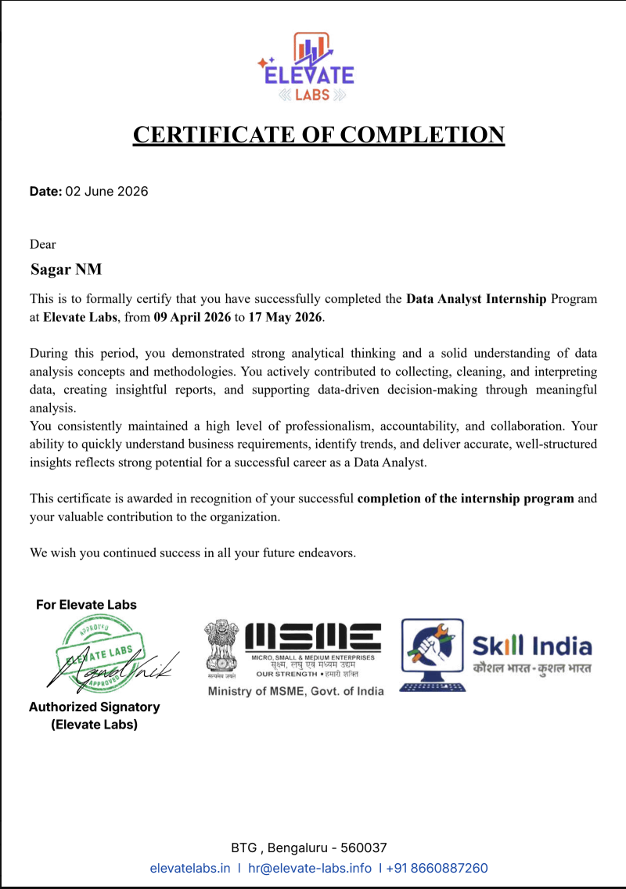

# 🚀 Elevate Labs Data Analyst Internship

This repository contains the tasks and projects completed during my **Elevate Labs Data Analyst Internship**, showcasing practical experience in Python, SQL, Power BI, and data analytics.

## 📂 Tasks & Projects (Day 1–30)

### 🟢 Phase 1: Task Phase (Day 1–15)

- **Day 1:** Data Cleaning & Preprocessing — Netflix Dataset
- **Day 2:** Data Visualization & Storytelling — Superstore Dashboard (Power BI)
- **Day 3:** SQL for Data Analysis — Superstore Dataset
- **Day 4:** Interactive Business Dashboard Design — Power BI
- **Day 5:** Exploratory Data Analysis — Titanic Dataset (Python)
- **Day 6:** Sales Trend Analysis Using SQL Aggregations
- **Day 7:** Data Importing and Exporting with Pandas
- **Day 8:** Handling Missing Values and Duplicate Records
- **Day 9:** Advanced SQL Queries — JOINs and Subqueries
- **Day 10:** Data Aggregation and Grouping
- **Day 11:** Statistical Analysis and Summary Statistics
- **Day 12:** Data Visualization Using Matplotlib and Seaborn
- **Day 13:** Customer Segmentation Analysis
- **Day 14:** Business KPI Analysis and Reporting
- **Day 15:** Mini Project — Retail Sales Data Analysis

### 🔵 Phase 2: Project Phase (Day 16–30)

- **Day 16:** Project Planning and Dataset Selection
- **Day 17:** Data Collection and Preparation
- **Day 18:** Data Cleaning and Transformation
- **Day 19:** Exploratory Data Analysis
- **Day 20:** SQL-Based Business Analysis
- **Day 21:** Customer and Sales Performance Analysis
- **Day 22:** Advanced Data Visualization
- **Day 23:** Power BI Dashboard Development
- **Day 24:** KPI Cards, Filters, and Interactive Reports
- **Day 25:** Time-Series and Trend Analysis
- **Day 26:** Profitability and Revenue Analysis
- **Day 27:** Dashboard Refinement and Validation
- **Day 28:** Project Documentation and Report Preparation
- **Day 29:** Final Insights and Recommendations
- **Day 30:** Final Project Submission and Presentation

## 📅 Internship Timeline

- **Days 1–15:** Task Phase
- **Days 16–30:** Project Phase
- **Days 31–45:** Final Evaluation

**Day 30 marks the end of the task and project phases. The complete internship concludes on Day 45 after evaluation.**

## 🛠️ Tools & Technologies

- Python — Pandas, Matplotlib, Seaborn
- MySQL
- Microsoft Power BI
- Google Colab / Jupyter Notebook
- Git & GitHub

## 🧠 Skills Developed

- Data Cleaning and Preprocessing
- SQL Queries and Data Analysis
- Exploratory Data Analysis (EDA)
- Statistical Analysis
- Data Visualization and Dashboard Design
- Business Intelligence and KPI Reporting
- Trend Analysis and Business Insights

## 📁 Repository Structure

Tasks and projects are organized by day in separate folders, such as `Day-1/`, `Day-2/`, and so on, up to `Day-30/`.

## 🔗 Connect With Me

- **GitHub:** [sagarnm248-bugburster](https://github.com/sagarnm248-bugburster)

---

*🚀 Learning, analyzing, and building throughout the 45-day internship.*

## 🏆 Internship Completion Certificate

I successfully completed the **Data Analyst Internship at Elevate Labs**, gaining hands-on experience in data cleaning, SQL analysis, Python, and Power BI.

